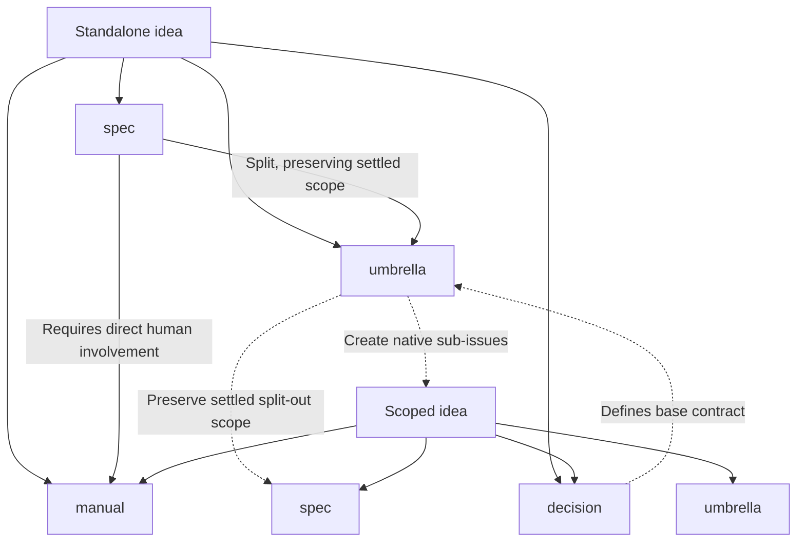

# Contributing

## Commit and pull request titles

Use plain, short descriptions that start with a capital letter. Do not add prefix labels or groups such as `backend:`, `chore:`, or `fix:`. For pull request titles, include the related issue number in parentheses.

## Documentation

Documentation consists of two types: **cookbooks**, which help readers complete a task, and **guides**, which help readers understand a topic or make decisions.

### Cookbooks

- Order steps as the reader performs them.
- For each step, state what to do, where to do it, and how to recognize success.
- Put commands next to their expected results. Use bullets for choices and checklists; use numbered steps when order matters.
- Include only what is needed to complete the task safely and correctly. Put prerequisites and warnings near the steps they affect.
- Link to guides for background or detailed reference instead of repeating it.
- Put checks after the thing being checked exists.

### Guides

- State the guide's scope and organize it around the topic and readers' likely questions.
- Explain relevant concepts, constraints, responsibilities, dependencies, and lifecycle.
- Distinguish current facts from recommendations, optional paths, and historical context.
- Use headings, lists, and tables to make information easy to find and compare.
- Keep procedures brief or link to a cookbook when readers need to perform a task.
- Define terms and avoid unexplained internal shorthand.

### All documentation

- Write for the reader's goal; keep information that helps them understand, decide, or act.
- Prefer concrete language and explicit names over vague instructions or unexplained jargon.
- Prefer diagrams for relationships, bullets for distinct rules (one per bullet), and numbered lists for ordered steps. Use short prose for context and rationale; do not repeat the same explanation in every format.
- Keep one source of truth for facts that could drift; cross-reference it rather than duplicating content.
- Start with scope, audience and related reading. With more than two headings, add a table of contents after the introduction; match numbered cookbook steps with a numbered contents list.
- Keep investigation evidence, test inventories and delivery tracking in issues or PRs. Include implementation details only when readers need them to act or understand; remove repetition, filler and progress history.

## Project formatting

Declare formatting in the second document of `.project.yaml`:

```yaml
format:
  - check: zig fmt --check $argv
    apply: zig fmt $argv
    files: ["**/*.zig"]
```

`mise run --raw in-devcontainer <project> format-check` checks formatting; `format` applies it. Both commands receive the same sorted, project-relative files as fish `$argv`. Globs use Git's `:(glob)` semantics, include tracked and non-ignored untracked files, and exclude deleted files.

Declare `format` as an ordered list of formatter entries. Each entry has its own `check`, `apply`, and `files`, so mixed-language projects can run the appropriate tool only on its selected files. Format checks and applies run sequentially in list order, both directly and through the single project-level Bazel format target.

Checks must not modify checkout files. Prefer a formatter's native non-mutating verification mode for each entry's `check`. When a formatter has no verification mode, declare `check: format-check-copy $format_apply $argv`: it runs that entry's `apply` command on temporary source/configuration copies inside the devcontainer and compares the selected files. It returns 3 for formatting differences and 2 for formatter errors. Bazel-backed precommit treats any nonzero check status as a signal to apply all formatter entries in order, then rechecks; formatter and recheck failures remain fatal. CI only checks. Precommit uses cacheable Bazel checks, applies only when formatting is needed, then rechecks to cache the formatted state. Keep formatter configuration and tool/version declarations in the project so their changes invalidate its check; root documentation does not. For formatters that only accept a whole project, use `format-apply-copy 'formatter command' $argv` to copy back only selected files, paired with `format-check-copy 'formatter command' $argv`.

## Dependency security updates

[Dependabot configuration](.github/dependabot.yml) covers all tracked npm/pnpm, Cargo, Go, pip, Maven, Gradle, and GitHub Actions dependency sources. Every entry sets `open-pull-requests-limit: 0`, disabling routine version-update PRs without disabling security-update PRs. The required `schedule` does not delay security fixes until a nightly window.

When adding a project or manifest, add its supported dependency sources to that configuration in the same change. The [coverage regression suite](.scripts/tests/dependabot.bats) discovers root-level projects' supported manifests and fails when a directory is missing or duplicated. New supported ecosystems or manifest layouts must also extend the suite's discovery and [Bazel inputs](.scripts/tests/groups.yaml); document unsupported sources below instead of silently omitting them.

Enable the dependency graph, Dependabot alerts, and Dependabot security updates in GitHub repository settings. Security fixes open ordinary PRs and run the existing Publish workflow, including AMD64 quality checks and ARM64 integration tests. Review the changes and require successful checks before merging; no automatic approval or merge is configured.

Dependabot security updates do not cover Docker/Compose images, Hex/Mix, Elm, or devcontainer dependencies, even though Dependabot supports version updates for those ecosystems. Nimble, opam, Mise pins, embedded tool downloads, and OS packages also need separate handling. Do not edit generated devcontainer or Compose files to update their dependencies; change their source configuration instead.

For pnpm 12 two-document lockfiles, GitHub fixed application dependency detection, but an existing graph may need rebuilding. Use **Security → Dependabot alerts → ⋯ → Refresh Dependabot alerts**, then verify application package names and versions in the dependency graph or its SBOM export. Do not treat disappearing alerts as proof of remediation. The package-manager environment document and dependency scope classification may still have coverage limitations. See [GitHub's dependency graph troubleshooting](https://docs.github.com/en/code-security/reference/supply-chain-security/troubleshoot-dependabot/dependency-graph-errors) and [supported ecosystems](https://docs.github.com/en/code-security/reference/supply-chain-security/supported-ecosystems-and-repositories).

## Issue planning and refinement

1. Present proposed issue content and related metadata/hierarchy changes.
2. End the turn and wait for confirmation before applying them.
3. Implement only with separate authorization, including documentation edits. Clarify mixed requests when authorization is unclear.

Use issues to capture and refine future work. Every issue in this process has exactly one workflow label: `idea`, `umbrella`, `spec`, `manual`, or `decision`. Other metadata labels may coexist. Labels describe issue type; open/closed state tracks completion.

- **`idea`:** Problem or wish, context and desired outcome. Research and unresolved requirements stay ideas; implementation hints are optional.
- **`umbrella`:** Overall outcome, scope, completion criteria, native children, base-contract decisions and dependency diagram.
- **`spec`:** Settled scope, behavior, constraints, dependencies and verifiable acceptance criteria for autonomous implementation. Minor implementation choices remain open.
- **`manual`:** Required human actions/approvals, prerequisites, evidence, safety boundaries and unresolved requirements. Agents may prepare and assist, not execute human-only steps. Blockers still apply.
- **`decision`:** Agreed context, approach, alternatives and consequences. May stand alone or belong to an umbrella; affected specs must conform.



Solid arrows change issue type; dashed arrows create children or reference contracts, not blockers. Nodes represent types, not individual issues.

- Replace the workflow label only when the type changes; preserve other metadata and resolve missing or conflicting workflow labels with the user.
- Separate automatable work from human-only steps when practical.
- Relate standalone decisions to affected issues natively and link the contract in their descriptions. Do not create an umbrella solely to hold a decision.

- Revise existing issues in place, preserving discussion, settled requirements, acceptance criteria and progress unless changes are agreed.
- Supersede material changes to accepted decisions in a new linked decision; preserve history and review affected specs.

- When splitting a spec, convert it into an umbrella and map every original requirement and acceptance criterion to children or overall completion criteria.
- Preserve settled child specs. Fully settled split-out scopes may be specs directly; unresolved children start as ideas.
- Review incoming/outgoing dependencies and update affected umbrellas when restructuring.

## Hierarchy, dependencies, and completion

- Add, remove, or change native issue relationships (parent/sub-issue, blocked-by, or relates-to) only with explicit operator authorization covering those changes. General refinement approval does not authorize undisclosed relationship changes.
- Preserve blocked-by relationships after prerequisites close or merge; GitHub handles whether they currently block work. Completion alone never authorizes relationship cleanup.
- Only umbrellas may have native sub-issues. If a child becomes an umbrella, attach its children directly to that new umbrella, not to ordinary issues.
- Model dependencies with GitHub's native **blocked by** relationships, not labels or diagrams alone. These may cross umbrella boundaries or involve standalone ideas and specs.
- When asked to relate issues that are not blockers or parent/child, create GitHub's native **Relates to** relationship. A prose or Markdown reference alone does not establish this relationship; keep references in descriptions when useful for context.
- Every umbrella includes a Mermaid `flowchart TD` of its direct children:
  - Node labels contain only the issue number, current title and ` (closed)` when applicable.
  - Each issue node links to its GitHub URL with a `click` directive.
  - Arrows run prerequisite-to-dependent and match native blockers; contract references are not automatically blockers.
  - Document external dependencies separately. No PR references or other metadata belong in the diagram.
- Whenever a child, dependency, or decision changes, update the umbrella's main description and diagram in the same task, not only its comments. Manual children retain native hierarchy and dependencies; keep workflow metadata outside diagram node labels.
- Implement specs only after authorization, settled material requirements and resolved blockers.
- Verify acceptance criteria, but keep PR-backed issues open with `Closes #…` in the PR description. Direct closure requires an explicit request.
- Tests, commits and publication mean **implemented, awaiting review**, not complete. Keep umbrella progress and blockers pending until merge.
- Close accepted decisions after approval, manual tasks after verified human actions, and umbrellas after their overall completion criteria are met.
- Refinement alone never completes implementation.
