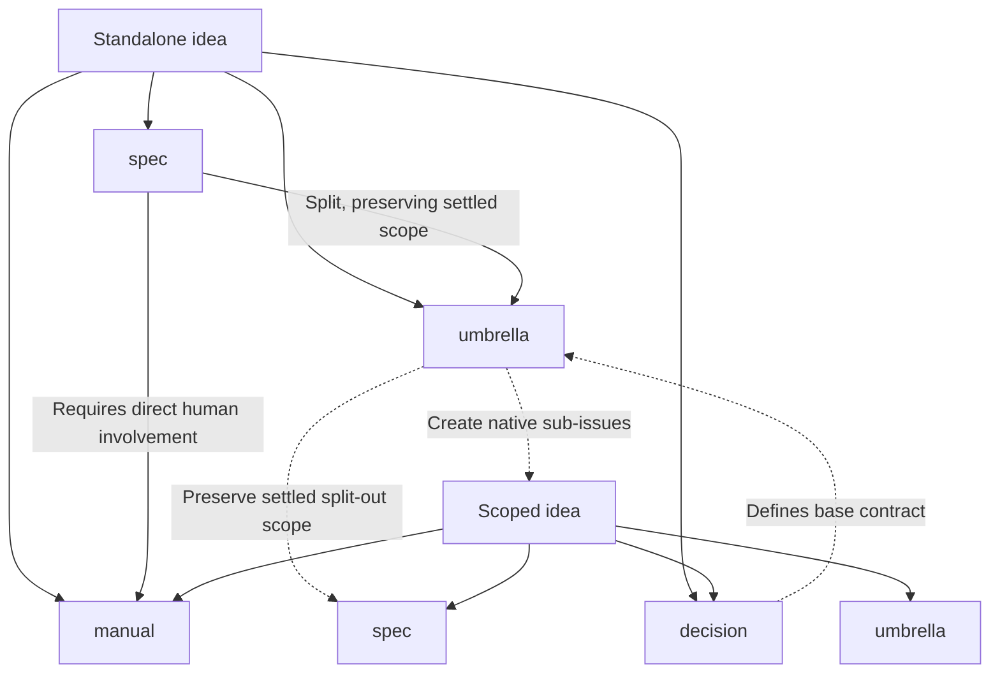

# Contributing

## Commit and pull request titles

Use plain, short descriptions that start with a capital letter. Do not add prefix labels or groups such as `backend:`, `chore:`, or `fix:`. For pull request titles, include the related issue number in parentheses.

## Documentation

Documentation consists of two types: **cookbooks**, which help readers complete a task, and **guides**, which help readers understand a topic or make decisions.

### Cookbooks

- Order steps as the reader performs them.
- For each step, state what to do, where to do it, and how to recognize success.
- Put commands next to their expected results. Use bullets for choices and checklists; use numbered steps when order matters.
- Include only what is needed to complete the task safely and correctly. Put prerequisites and warnings near the steps they affect.
- Link to guides for background or detailed reference instead of repeating it.
- Put checks after the thing being checked exists.

### Guides

- State the guide's scope and organize it around the topic and readers' likely questions.
- Explain relevant concepts, constraints, responsibilities, dependencies, and lifecycle.
- Distinguish current facts from recommendations, optional paths, and historical context.
- Use headings, lists, and tables to make information easy to find and compare.
- Keep procedures brief or link to a cookbook when readers need to perform a task.
- Define terms and avoid unexplained internal shorthand.

### All documentation

- Write for the reader's goal; keep information that helps them understand, decide, or act.
- Prefer concrete language and explicit names over vague instructions or unexplained jargon.
- Keep one source of truth for facts that could drift; cross-reference it rather than duplicating content.
- Remove repetition, filler, progress history, and implementation details that do not serve the document's purpose.

## Project formatting

Declare formatting in the second document of `.project.yaml`:

```yaml
format:
  - check: zig fmt --check $argv
    apply: zig fmt $argv
    files: ["**/*.zig"]
```

`mise run --raw in-devcontainer <project> format-check` checks formatting; `format` applies it. Both commands receive the same sorted, project-relative files as fish `$argv`. Globs use Git's `:(glob)` semantics, include tracked and non-ignored untracked files, and exclude deleted files.

Declare `format` as an ordered list of formatter entries. Each entry has its own `check`, `apply`, and `files`, so mixed-language projects can run the appropriate tool only on its selected files. Format checks and applies run sequentially in list order, both directly and through the single project-level Bazel format target.

Checks must not modify checkout files. Prefer a formatter's native non-mutating verification mode for each entry's `check`. When a formatter has no verification mode, declare `check: format-check-copy $format_apply $argv`: it runs that entry's `apply` command on temporary source/configuration copies inside the devcontainer and compares the selected files. It returns 3 for formatting differences and 2 for formatter errors. Bazel-backed precommit treats any nonzero check status as a signal to apply all formatter entries in order, then rechecks; formatter and recheck failures remain fatal. CI only checks. Precommit uses cacheable Bazel checks, applies only when formatting is needed, then rechecks to cache the formatted state. Keep formatter configuration and tool/version declarations in the project so their changes invalidate its check; root documentation does not. For formatters that only accept a whole project, use `format-apply-copy 'formatter command' $argv` to copy back only selected files, paired with `format-check-copy 'formatter command' $argv`.

## Dependency security updates

[Dependabot configuration](.github/dependabot.yml) covers all tracked npm/pnpm, Cargo, Go, pip, Maven, Gradle, and GitHub Actions dependency sources. Every entry sets `open-pull-requests-limit: 0`, disabling routine version-update PRs without disabling security-update PRs. The required `schedule` does not delay security fixes until a nightly window.

When adding a project or manifest, add its supported dependency sources to that configuration in the same change. The [coverage regression suite](.scripts/tests/dependabot.bats) discovers root-level projects' supported manifests and fails when a directory is missing or duplicated. New supported ecosystems or manifest layouts must also extend the suite's discovery and [Bazel inputs](.scripts/tests/groups.yaml); document unsupported sources below instead of silently omitting them.

Enable the dependency graph, Dependabot alerts, and Dependabot security updates in GitHub repository settings. Security fixes open ordinary PRs and run the existing Publish workflow, including AMD64 quality checks and ARM64 integration tests. Review the changes and require successful checks before merging; no automatic approval or merge is configured.

Dependabot security updates do not cover Docker/Compose images, Hex/Mix, Elm, or devcontainer dependencies, even though Dependabot supports version updates for those ecosystems. Nimble, opam, Mise pins, embedded tool downloads, and OS packages also need separate handling. Do not edit generated devcontainer or Compose files to update their dependencies; change their source configuration instead.

For pnpm 12 two-document lockfiles, GitHub fixed application dependency detection, but an existing graph may need rebuilding. Use **Security → Dependabot alerts → ⋯ → Refresh Dependabot alerts**, then verify application package names and versions in the dependency graph or its SBOM export. Do not treat disappearing alerts as proof of remediation. The package-manager environment document and dependency scope classification may still have coverage limitations. See [GitHub's dependency graph troubleshooting](https://docs.github.com/en/code-security/reference/supply-chain-security/troubleshoot-dependabot/dependency-graph-errors) and [supported ecosystems](https://docs.github.com/en/code-security/reference/supply-chain-security/supported-ecosystems-and-repositories).

## Issue planning and refinement

Use issues to capture and refine future work. Every issue in this process has exactly one workflow label: `idea`, `umbrella`, `spec`, `manual`, or `decision`. Other metadata labels may coexist. Labels describe issue type; open/closed state tracks completion.

- **`idea` — Capture:** State the problem or feature wish, context, and desired outcome. Implementation hints are welcome; a specification is not required.
- **`umbrella` — Coordinate:** Refine a larger idea into an outcome with scope, completion criteria, and native sub-issues, initially labeled `idea`. Maintain current progress, a linked base contract of decisions, and a dependency diagram in the description.
- **`spec` — Implement:** Define scope, expected behavior, constraints, dependencies, and verifiable acceptance criteria so an autonomous agent can implement without guessing material requirements. Settle significant decisions; allow minor implementation choices to be resolved by the agent and review.
- **`manual` — Human action:** Track work that cannot be completed autonomously and requires the operator's direct action or approval. Record the required human involvement, prerequisites, completion evidence, safety boundaries, and any unresolved requirements. Agents may help refine the task, prepare checklists, and assist, but must not independently execute the human-only steps or claim completion. The label does not imply readiness or waive blockers; close only after verified completion.
- **`decision` — Record:** Preserve an agreed contract: context, chosen approach, alternatives, and consequences. Decisions may stand alone or belong to an umbrella. Relate standalone decisions to affected issues with native **Relates to** relationships and link the contract in their descriptions; do not create an umbrella solely to hold a decision. Umbrellas reference their decisions as part of their base contract. Affected specs must conform to the applicable contract. Close decisions when accepted; record material changes in explicitly superseding decisions and review affected specs.

When refinement changes the issue type, replace the previous workflow label, preserving the issue and its discussion. Any idea may become manual when direct human involvement is required; existing specs may also become manual without losing their settled scope or acceptance criteria. Separate automatable specs from manual steps when work can be split, attaching them to an umbrella if a parent is needed. Standalone ideas become specs, umbrellas, manual tasks, or decisions when their purpose is to record an agreed contract rather than track implementation. Research, exploration, and unresolved requirements otherwise remain ideas.

Refinement is not limited to ideas: revise existing specs and restructure umbrellas in place, retaining the workflow label when the issue type is unchanged. Preserve settled requirements, acceptance criteria, and implementation progress unless a change is explicitly agreed. Revisit accepted decisions through explicitly superseding decisions for material contract changes, not by rewriting the historical agreement.

To split a spec, convert the existing issue into an umbrella and attach the resulting scopes as native sub-issues. Map every original requirement and acceptance criterion to child scope or umbrella completion criteria. Preserve existing specs and create fully settled, implementation-ready child scopes directly as specs; only unresolved new scope starts as ideas. Review incoming and outgoing native dependencies against the split, updating affected umbrellas and their diagrams. Refinement alone does not close work or reset its completion state.



Solid arrows are label transitions. Dashed arrows create sub-issues or reference contracts, not blocked-by dependencies. This diagram describes issue types, not individual issues.

## Hierarchy, dependencies, and completion

- Only umbrellas may have native sub-issues. If a child becomes an umbrella, attach its children directly to that new umbrella, not to ordinary issues.
- Model dependencies with GitHub's native **blocked by** relationships, not labels or diagrams alone. These may cross umbrella boundaries or involve standalone ideas and specs.
- When asked to relate issues that are not blockers or parent/child, create GitHub's native **Relates to** relationship. A prose or Markdown reference alone does not establish this relationship; keep references in descriptions when useful for context.
- Every umbrella must include a Mermaid `flowchart TD` showing implementation order and dependencies among its direct sub-issues. Each node label must contain only the issue number and current issue title, followed by ` (closed)` if the issue is closed (for example, `#123 Issue title (closed)`). Do not add other metadata to node labels or include PR references anywhere in the diagram. Every node representing an issue must link to that issue using a Mermaid `click` directive with its GitHub URL. Use prerequisite-to-dependent arrows matching native blocked-by relationships. Keep external dependencies out of this diagram; document them separately. Contract references are not automatically blockers.
- Whenever a child, dependency, or decision changes, update the umbrella's main description and diagram in the same task, not only its comments. Manual children retain native hierarchy and dependencies; keep workflow metadata outside diagram node labels.
- Implement specs only after blockers are resolved. Clarify material ambiguities before implementation.
- Close specs after verifying acceptance criteria and manual tasks after verifying completion of the required human actions. Close umbrellas only when their overall completion criteria are met; refinement alone is not implementation.
