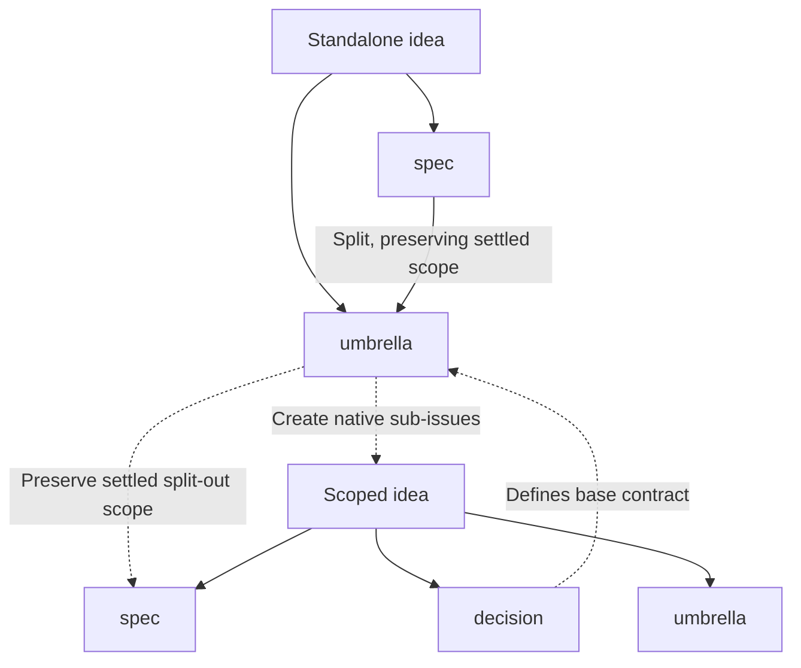

# Contributing

## Project formatting

Declare formatting in the second document of `.project.yaml`:

```yaml
format:
  check: format-check-copy $format_apply $argv
  apply: gofmt -w $argv
  files: ["**/*.go"]
```

`mise run --raw in-devcontainer <project> format-check` checks formatting; `format` applies it. Both commands receive the same sorted, project-relative files as fish `$argv`. Globs use Git's `:(glob)` semantics, include tracked and non-ignored untracked files, and exclude deleted files.

Checks must not modify checkout files. `format-check-copy` runs `$format_apply` (the configured apply command) on temporary source/configuration copies inside the devcontainer and compares the selected files. It returns 3 for unformatted files and 2 for formatter errors. Custom check commands should use the same exit codes; other failures are fatal. CI only checks. Precommit uses cacheable Bazel checks, applies only when formatting is needed, then rechecks to cache the formatted state. Keep formatter configuration and tool/version declarations in the project so their changes invalidate its check; root documentation does not. For tools that only accept a whole project, use `format-apply-copy 'formatter command' $argv` to copy back only selected files, paired with `format-check-copy 'formatter command' $argv`.

## Issue planning and refinement

Use issues to capture and refine future work. Every issue in this process has exactly one workflow label: `idea`, `umbrella`, `spec`, or `decision`. Other metadata labels may coexist. Labels describe issue type; open/closed state tracks completion.

- **`idea` — Capture:** State the problem or feature wish, context, and desired outcome. Implementation hints are welcome; a specification is not required.
- **`umbrella` — Coordinate:** Refine a larger idea into an outcome with scope, completion criteria, and native sub-issues, initially labeled `idea`. Maintain current progress, a linked base contract of decisions, and a dependency diagram in the description.
- **`spec` — Implement:** Define scope, expected behavior, constraints, dependencies, and verifiable acceptance criteria so an autonomous agent can implement without guessing material requirements. Settle significant decisions; allow minor implementation choices to be resolved by the agent and review.
- **`decision` — Record:** Preserve an agreed, umbrella-scoped contract: context, chosen approach, alternatives, and consequences. Every decision belongs to exactly one umbrella, which references it as part of its base contract. Child specs must conform to that contract. Close decisions when accepted; record material changes in explicitly superseding decisions and review affected specs.

When refinement changes the issue type, replace the previous workflow label, preserving the issue and its discussion. Standalone ideas become specs or umbrellas, never decisions. Research, exploration, and unresolved requirements remain ideas.

Refinement is not limited to ideas: revise existing specs and restructure umbrellas in place, retaining the workflow label when the issue type is unchanged. Preserve settled requirements, acceptance criteria, and implementation progress unless a change is explicitly agreed. Revisit accepted decisions through explicitly superseding decisions for material contract changes, not by rewriting the historical agreement.

To split a spec, convert the existing issue into an umbrella and attach the resulting scopes as native sub-issues. Map every original requirement and acceptance criterion to child scope or umbrella completion criteria. Preserve existing specs and create fully settled, implementation-ready child scopes directly as specs; only unresolved new scope starts as ideas. Review incoming and outgoing native dependencies against the split, updating affected umbrellas and their diagrams. Refinement alone does not close work or reset its completion state.



Solid arrows are label transitions. Dashed arrows create sub-issues or reference contracts, not blocked-by dependencies. This diagram describes issue types, not individual issues.

## Hierarchy, dependencies, and completion

- Only umbrellas may have native sub-issues. If a child becomes an umbrella, attach its children directly to that new umbrella, not to ordinary issues.
- Model dependencies with GitHub's native **blocked by** relationships, not labels or diagrams alone. These may cross umbrella boundaries or involve standalone ideas and specs.
- When asked to relate issues that are not blockers or parent/child, create GitHub's native **Relates to** relationship. A prose or Markdown reference alone does not establish this relationship; keep references in descriptions when useful for context.
- Every umbrella must include a Mermaid `flowchart TD` showing implementation order and dependencies among its direct sub-issues. Each node label must contain only the issue number and current issue title, followed by ` (closed)` if the issue is closed (for example, `#123 Issue title (closed)`). Do not add other metadata to node labels or include PR references anywhere in the diagram. Every node representing an issue must link to that issue using a Mermaid `click` directive with its GitHub URL. Use prerequisite-to-dependent arrows matching native blocked-by relationships. Keep external dependencies out of this diagram; document them separately. Contract references are not automatically blockers.
- Whenever a child, dependency, or decision changes, update the umbrella's main description and diagram in the same task, not only its comments.
- Implement specs only after blockers are resolved. Clarify material ambiguities before implementation.
- Close specs after verifying acceptance criteria. Close umbrellas only when their overall completion criteria are met; refinement alone is not implementation.
