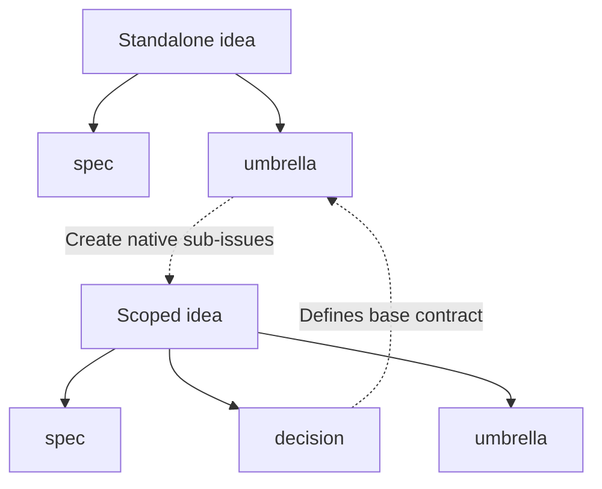

# Contributing

## Issue planning and refinement

Use issues to capture and refine future work. Every issue in this process has exactly one workflow label: `idea`, `umbrella`, `spec`, or `decision`. Other metadata labels may coexist. Labels describe issue type; open/closed state tracks completion.

- **`idea` — Capture:** State the problem or feature wish, context, and desired outcome. Implementation hints are welcome; a specification is not required.
- **`umbrella` — Coordinate:** Refine a larger idea into an outcome with scope, completion criteria, and native sub-issues, initially labeled `idea`. Maintain current progress, a linked base contract of decisions, and a dependency diagram in the description.
- **`spec` — Implement:** Define scope, expected behavior, constraints, dependencies, and verifiable acceptance criteria so an autonomous agent can implement without guessing material requirements. Settle significant decisions; allow minor implementation choices to be resolved by the agent and review.
- **`decision` — Record:** Preserve an agreed, umbrella-scoped contract: context, chosen approach, alternatives, and consequences. Every decision belongs to exactly one umbrella, which references it as part of its base contract. Child specs must conform to that contract. Close decisions when accepted; record material changes in explicitly superseding decisions and review affected specs.

Refinement replaces the previous workflow label, preserving the issue and its discussion. Standalone ideas become specs or umbrellas, never decisions. Research, exploration, and unresolved requirements remain ideas.

Solid arrows are label transitions. Dashed arrows create sub-issues or reference contracts, not blocked-by dependencies. This diagram describes issue types, not individual issues.

## Hierarchy, dependencies, and completion

- Only umbrellas may have native sub-issues. If a child becomes an umbrella, attach its children directly to that new umbrella, not to ordinary issues.
- Model dependencies with GitHub's native **blocked by** relationships, not labels or diagrams alone. These may cross umbrella boundaries or involve standalone ideas and specs.
- Every umbrella must include a Mermaid `flowchart TD` showing implementation order and dependencies among its direct sub-issues. Every node representing an issue must link to that issue using a Mermaid `click` directive with its GitHub URL. Use prerequisite-to-dependent arrows matching native blocked-by relationships. Keep external dependencies out of this diagram; document them separately. Contract references are not automatically blockers.
- Whenever a child, dependency, or decision changes, update the umbrella's main description and diagram in the same task, not only its comments.
- Implement specs only after blockers are resolved. Clarify material ambiguities before implementation.
- Close specs after verifying acceptance criteria. Close umbrellas only when their overall completion criteria are met; refinement alone is not implementation.
